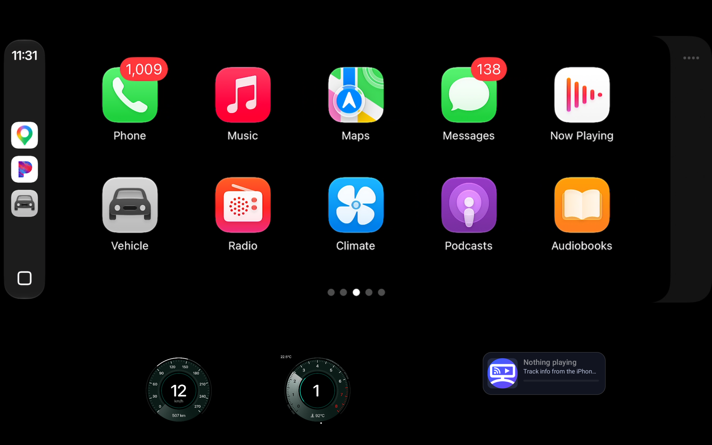
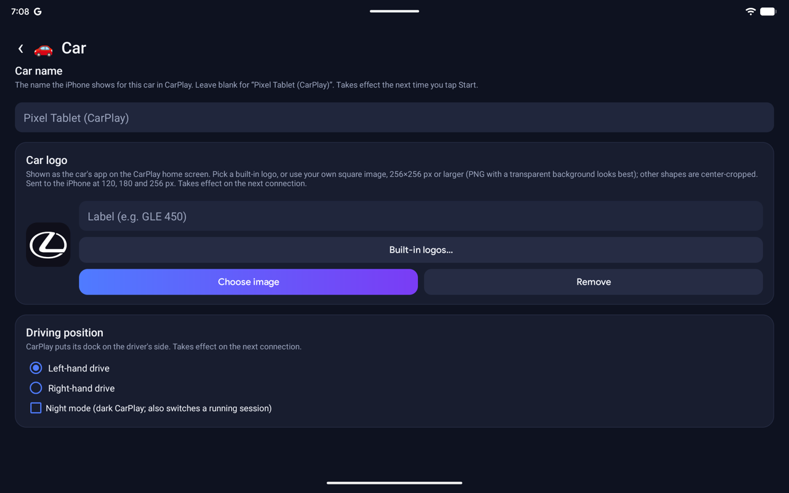

# CarCast for Android

[← CarCast overview](../README.md)

**Download:** [CarCast for Android 0.3.24](https://github.com/rPlayAI/carcast-public/releases/tag/android-0.3.24) (APK; test build, stops working after 90 days, on 2027-01-19).

*CarPlay on a Pixel Tablet, with the CarPlay Ultra instrument cluster (speedometer and tachometer) drawn by CarCast below the main screen, and the Now Playing card.*

## Home

Each mode has its own tab: **CarPlay**, **Mirroring**, **AirPlay** and **DLNA**.

| CarPlay | Mirroring |
|---|---|
|  |  |
| **AirPlay** | **DLNA** |
|  |  |

## Settings

| Settings | Set up CarPlay (wizard) |
|---|---|
|  |  |
| **Display:** resolution, video playback, instrument cluster size and content, two cluster streams, Now Playing card, knob input | **Wireless:** how the iPhone joins Wi-Fi after Bluetooth (this device's network, a private hotspot, a mobile hotspot or Wi-Fi Direct at 5 GHz) |
|  |  |
| **Car:** the car name and logo the iPhone shows in CarPlay | **Phones:** paired iPhones, pairing and discoverability |
|  |  |
| **AirPlay:** receiver name, mirroring resolution, password, full screen, start at boot | **DLNA:** receiver name, UPnP AV version |
|  |  |
| **General:** which modes are enabled | |
|  | |

## Features

- **Wired and wireless CarPlay.** Connect over USB, or pair over Bluetooth and hand off to Wi-Fi.
- **Several phones.** Pair more than one iPhone and switch between them from the home screen.
- **A step-by-step setup wizard.**
- **Car profiles.** Choose the display preset, the OEM icon and label, and the instrument cluster layout (map, app or turn card, with one or two cluster displays).
- **Built-in car logos.** More than 110 car brands (plus bicycle and motorcycle), the same set as iCarCast, or your own image.
- **Driving position and night mode.** Left- or right-hand drive (CarPlay puts its dock on the driver's side), and a dark CarPlay.
- **Return to Car.** The car icon in CarPlay switches to the native screen, and one tap takes you back to CarPlay.
- **More than CarPlay.**
  - **Mirroring:** shows the iPhone screen, with Bluetooth control of the phone.
  - **AirPlay receiver.**
  - **DLNA renderer.**
- **Share logs.** Send a session log after a failed connect.

Requirements: an Android tablet, phone or head unit running Android 5.0 or later (wireless setup with the device's own hotspot needs 8.0), and an iPhone with CarPlay enabled.
