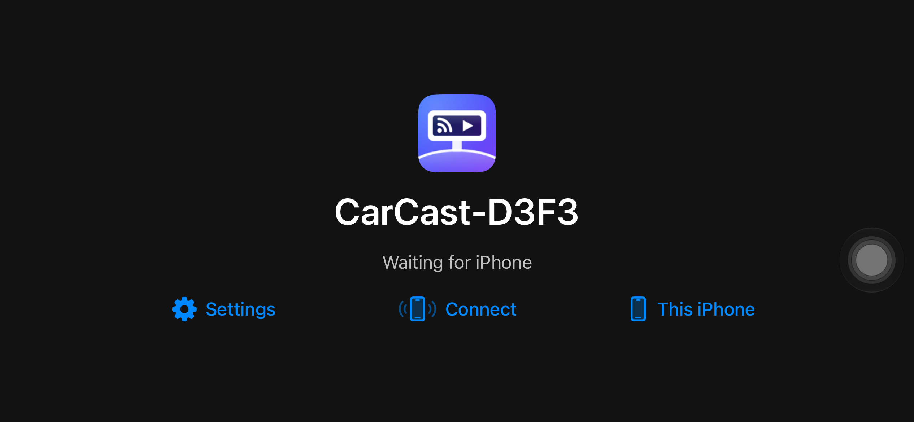
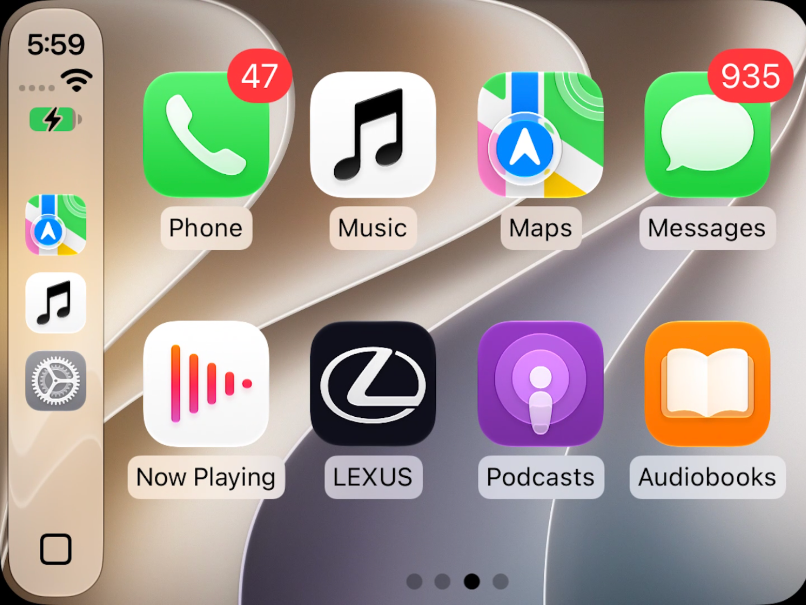
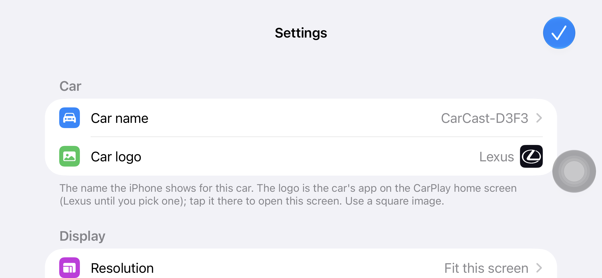
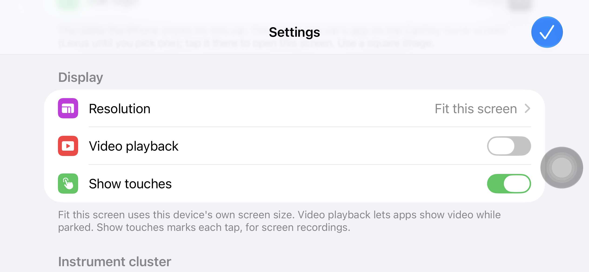
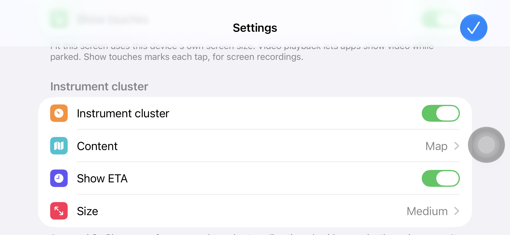

# iCarCast user guide

iCarCast is CarCast for iPhone and iPad. It turns an iPad or an iPhone into a CarPlay screen, and it can run CarPlay
on the iPhone itself. It can also show **Android Auto** from an Android phone (experimental, see
[Android Auto](#android-auto)). On the home screen the app is called **CarCast**.

## What you can do

| Device | Use |
|---|---|
| **iPad** | A CarPlay screen for your iPhone, for example mounted in a car that has no CarPlay. |
| **iPhone** | The same, as a screen for another iPhone. |
| | **This iPhone:** CarPlay on the same iPhone, full screen. |
| | **Connect:** send CarPlay from this iPhone to an iPad (or another iPhone) running CarCast. |
| **Either** | **Android Auto** (experimental, off by default): the screen for an Android phone. |

You need iOS or iPadOS 15 or later, and an iPhone with CarPlay enabled (Settings › General › CarPlay).

## Installing

- **TestFlight:** open [https://testflight.apple.com/join/mgpX2urq](https://testflight.apple.com/join/mgpX2urq) on the iPhone or iPad and install **iCarCast** from the TestFlight
  app.
- **Sideloading:** download the `.ipa` from [Releases](https://github.com/rPlayAI/carcast-public/releases) when one is
  posted, and install it with AltStore, SideStore or Sideloadly.

On first launch, allow what CarCast asks for:

- **Local Network**, so the iPhone can find the CarCast screen.
- **Location**, because iOS only tells apps the Wi-Fi network's name when location is allowed.
- **Bluetooth**.

## The home screen

The screen shows this device's car name (`CarCast-XXXX`) and what it is doing, with these buttons:

- **Settings**: car name, logo, display and instrument cluster.
- **Connect** (iPhone): start CarPlay on another CarCast screen.
- **This iPhone** (iPhone): CarPlay on this iPhone.
- **Stop**: replaces Connect or This iPhone while CarPlay is starting or running, and ends it.
- **Back to CarPlay**: appears when you've left CarPlay for CarCast's own screen (below).

## Using an iPad as the CarPlay screen

1. Open CarCast on the iPad. It shows **Waiting for iPhone**.
2. Put the iPhone and the iPad on the same network. In the car, turn on **Personal Hotspot** on the iPhone and join it
   from the iPad.
3. On the iPhone, open CarCast and tap **Connect**, then pick the iPad by its name.

CarPlay appears on the iPad and its sound plays from the iPad. Touch works as on a car screen.

The first time, the iPhone asks **Allow CarPlay While Locked?** That card can't be tapped while CarPlay is on screen;
answer it on the iPhone in Settings › General › CarPlay › `CarCast-XXXX`. You're asked once per CarCast device.

## This iPhone

Tap **This iPhone**. CarPlay fills the iPhone's screen, the way it would look in a car, and sound stays on the iPhone.
Tap **Stop** to end it.

At home, be on Wi-Fi. In the car, turn on **Personal Hotspot** and keep Wi-Fi on. If CarPlay doesn't appear within
about 10 seconds, CarCast tries once more by itself; if it still doesn't start, tap **This iPhone** again.

**The Wi-Fi password.** iOS saves the network This iPhone runs on as the car's Wi-Fi, together with the password
CarCast gives it, so on a network with a password CarCast asks for the real one the first time. It's kept on this
iPhone only (in the Keychain) and not asked again; press and hold **This iPhone** to enter it again if it changes.

**Café and public Wi-Fi.** Some networks can't be described to CarPlay without changing how the iPhone joins them
(newer "Enhanced Open" café networks, and company or school networks that ask for a username). On those, CarCast
doesn't start and says *CarPlay can't start on "…"*. Disconnect from that network in Control Center, turn on
**Personal Hotspot**, then tap **This iPhone**.

## The car icon and Back to CarPlay

The CarPlay home screen has an icon for the car itself (LEXUS until you choose your own logo). Tap it to leave CarPlay
for CarCast's own screen, which says **CarPlay is connected**. Tap **Back to CarPlay** to return, or **Settings** to
change the car.

## Settings

| Car | Display | Instrument cluster |
|---|---|---|
|  |  |  |

**Car**

- **Car name**: the name the iPhone shows for this car.
- **Car logo**: the car's icon on the CarPlay home screen. Choose a square image; **Remove** goes back to the default.

**Display**

- **Resolution**: *Fit this screen* (this device's own screen size), *Widescreen (1920 × 720)*, *Standard (800 × 480)*
  or *Full HD (1920 × 1080)*.
- **Video playback**: lets apps that support it show video on the CarPlay screen while parked.
- **Show touches**: marks each tap, for screen recordings. Takes effect at once.

**Instrument cluster**

A second CarPlay screen, like the one behind a car's steering wheel, shown beside or under the main screen. It has no
touch input, as in a car.

- **Content**: *Map*, *Turn card* (the next turn) or *Navigation app decides*.
- **Show ETA**: the arrival time on the cluster.
- **Size**: *Small*, *Medium* or *Large*.

**About** shows the version and this device's details, for problem reports.

Most changes are read by the iPhone when it connects, so CarCast offers **Quit CarCast** after a change: open it again
and reconnect for the change to take effect.

## Android Auto

The iPad (or iPhone) can be the screen for an Android phone too. It's experimental and off by default.

1. On the iPad: CarCast › **Settings › Modes** › turn on **Android Auto**. An **Android Auto** button appears on the
   home screen. (Turn **CarPlay** off there if you only want Android Auto; one of the two always stays on.)
2. On the Android phone, once: open **Android Auto › Settings**, tap the **version** 10 times to unlock developer
   settings, then **⋮ › Start head unit server**. Do this again after the phone restarts.
3. Put both on the same network: the same Wi-Fi at home, or in the car the iPad on the **Android phone's hotspot**.
4. On the iPad, tap **Android Auto**. Enter the phone's IP address (on the phone's hotspot CarCast fills it in) and
   the port, **5277** unless you changed it, then **Connect**.

Android Auto appears on the iPad, landscape, with touch and sound. Tap **Android Auto** again to stop. If it says
*Waiting for the Android phone*, check the head unit server is running and the address is the phone's (Settings ›
About phone › Status, or the hotspot's gateway).

## Wi-Fi and networks

Where you are decides what to switch on: at home, the same Wi-Fi for both devices; in the car, the iPhone's Personal
Hotspot, with Wi-Fi on. Wi-Fi must never be switched off. The **[Wi-Fi and network guide](ios-network-guide.md)**
covers every case.

## Open CarCast automatically

iOS doesn't let apps start themselves, but a Shortcuts automation can: Shortcuts › Automation › New › **Charger** (the
iPad on car power) or **Bluetooth** (your car) › action **Open App › CarCast** › **Run Immediately**.

## Troubleshooting

| Problem | Try |
|---|---|
| **No CarCast screen found on this Wi-Fi** | Both devices on the same network; Local Network allowed for CarCast on both; avoid public or hotel Wi-Fi (use the iPhone's hotspot). |
| **CarPlay didn't start** | Check Wi-Fi is on (and Personal Hotspot in the car), then tap the button again. |
| **CarPlay can't start on "…"** | That network can't be used for This iPhone. Disconnect from it in Control Center, turn on Personal Hotspot, tap This iPhone. |
| **The iPhone can't join a Wi-Fi network any more** after using This iPhone ("Unable to join", or a password is asked on a network that has none) | See [If a Wi-Fi network stopped working](#if-a-wi-fi-network-stopped-working) below. |
| CarPlay worked before, now never starts | Restart the iPhone. |
| A setting didn't change anything | Quit CarCast, open it again and reconnect. |
| No **Android Auto** button | Turn it on in Settings › Modes. |
| **Android Auto** waits and never starts | Start the head unit server on the phone again (step 2 of [Android Auto](#android-auto)), check the phone's IP address and port 5277, and that both are on the same network. |

### If a Wi-Fi network stopped working

Early test versions of iCarCast (TestFlight builds 1 to 4) could change a saved Wi-Fi network when you used
**This iPhone** on it, typically a café or store network: afterwards the iPhone says it's unable to join, asks for a
password that network doesn't have, and **Forget This Network** doesn't help. The network is fine; the iPhone's saved
copy of it was changed. To fix it:

1. On the iPhone: **Settings › General › CarPlay ›** `CarCast-XXXX` **› Forget This Car.** While the car is
   remembered, the iPhone keeps the network as the car's Wi-Fi.
2. **Settings › Wi-Fi ›** ⓘ next to the network **› Forget This Network.**
3. Join the network again as usual.

If it still won't join, turn Wi-Fi off and on, then restart the iPhone. Then update iCarCast in TestFlight: build 6
and later never change a network (see **The Wi-Fi password** and **Café and public Wi-Fi** above).

Still stuck? [Report a problem](https://github.com/rPlayAI/carcast-public/issues/new/choose) with both devices' models
and iOS versions, and what you tried.
