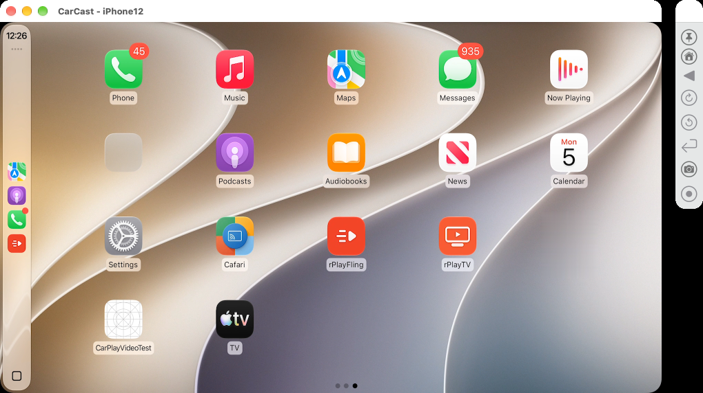

# CarCast for macOS

[← CarCast overview](../README.md)

*CarPlay from an iPhone 12 on **iOS 27.2** in a CarCast window on macOS. rPlayFling and rPlayTV are third-party CarPlay apps shown alongside the built-in ones; the side bar has the Home, Back and knob controls, plus screenshot and recording buttons.*

- **Wired CarPlay over USB.** Connect an iPhone with a cable and CarPlay starts in a window.
- **Configurable vehicle.**
  - Screen size, resolution and display presets.
  - Car name and OEM icon.
  - Touch, knob or touchpad input.
- **Instrument cluster.** A second display for the cluster stream (maps and turn-by-turn cards).
- **Audio.** Media, navigation prompts, Siri and phone calls.
- **Video in the car.** Video from supported apps plays on the CarPlay screen.
- **Protocol inspector.** Logs the phone ↔ head-unit conversation in readable form (iAP2 messages, AirPlay control requests, stream setup). The usual question this answers is why a phone or app behaves differently in the car.

## Protocol Inspector

*Every message in the session, decoded: the iAP2 control messages (identification, authentication, vehicle status, Now Playing) and the AirPlay HTTP/RTSP requests and responses. You can filter by channel, search, and view the parsed fields and raw bytes of each message.*

## The app

| Home | CarPlay |
|---|---|
|  |  |
| **Control** | **Knob** |
|  |  |

- **Home:** starts and stops the receiver.
- **CarPlay:** sets up the head unit that CarCast presents to the phone.
  - Display preset.
  - Video in the car.
  - Instrument cluster.
  - Knob or touch-only input.
  - Now Playing.
  - Car logo.
- **Control:** sets how the Mac's mouse and keyboard drive the iPhone (relative mouse, absolute mouse or touch).
- **Knob:** an on-screen rotary controller for head units without a touchscreen, also usable from the keyboard.

Requirements: a Mac with Apple silicon or Intel, an iPhone with CarPlay enabled, and a USB cable.
