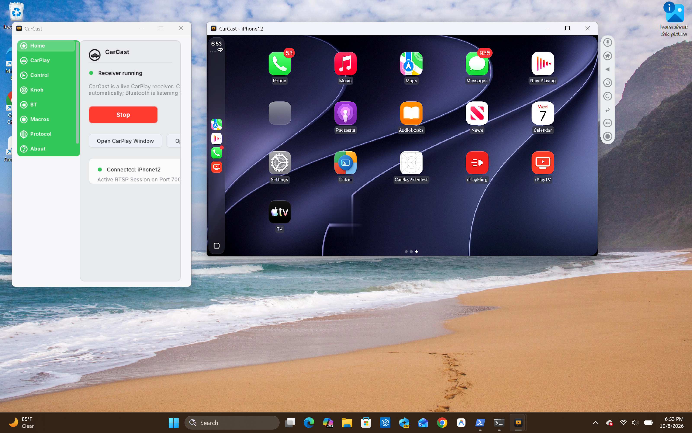
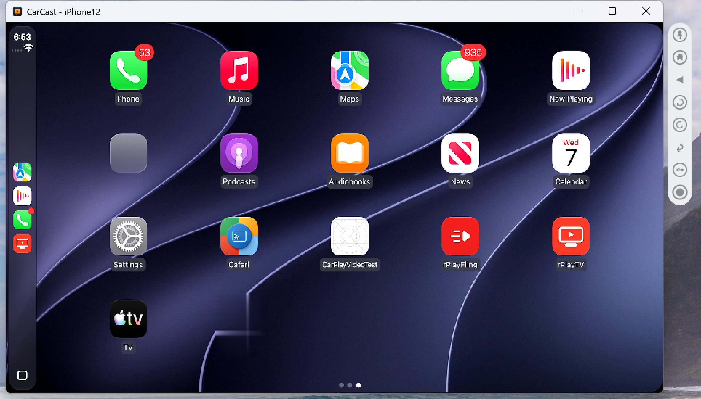

# CarCast for Windows

[← CarCast overview](../README.md)

*CarPlay from an iPhone 12 on **iOS 27.2**, running live on Windows 11 with CarCast. The dedicated CarPlay screen features a top-aligned companion toolbar with Home, Back, knob rotary controls, and screenshot/recording actions.*

## The app

| Desktop Overview | CarPlay Display | Main Control |
|---|---|---|
|  |  |  |

- **Wired CarPlay over USB CDC-NCM:** Connect an iPhone via USB cable and CarPlay starts automatically in a native window with low latency.
- **Top-Aligned Companion Toolbar:** Floating, rounded pill matching the macOS layout with fast access to Home, Back, Rotary knob controls, and screenshot tools.
- **CarPlay Video Playback:** Multi-threaded FFmpeg engine with H.264 video decoding, NV12 rendering, and resampled 48kHz audio.
- **Instrument Cluster Display:** Dedicated cluster display window support for turn-by-turn navigation cards and maps.
- **Protocol & Session Inspector:** Real-time diagnostics for iAP2 packets, RTSP exchanges, and AirPlay stream telemetry.

Requirements: a PC running Windows 11 or Windows 10 (64-bit), an iPhone with CarPlay enabled, and a USB cable.

## Windows Installation

Download and run the self-contained installer **`CarCast-Setup-1.0.0-x64.exe`** (available under Releases). The setup wizard bundles all required runtime libraries (FFmpeg codecs, SDL2 audio/video, libimobiledevice, Apple Bonjour) and automatically configures the necessary USB filter drivers with desktop and Start Menu shortcuts.
